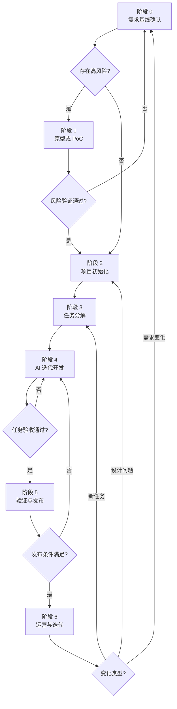

# 开发模型选择与开发流程规划（DEVELOPMENT_APPROACH）

> 本文件是「开发模型选择与开发流程规划」阶段的产物，回答一个项目**今后应该如何使用 AI 来开发**：
>
> - 采用什么开发模型，为什么；
> - 后续分成哪些阶段，每个阶段做什么；
> - AI 和人分别负责什么，怎样协作和验收。
>
> 填写规则：
> - 所有条目只使用五种状态：`confirmed`、`pending`、`conflict`、`assumption`、`deferred`。
> - AI 的推荐只有在用户确认后才能标为 `confirmed`；否则保持 `assumption`。
> - 没有相关内容的章节写“不适用”，并说明原因；不为了填满模板而编造内容。
> - 记录必须自包含：不写 `Q1=A`、`Q2=B`；写完整问题与结论。
> - 不把“按推荐”“都同意”当成结论；写出被采纳的内容。
> - 本文件不写功能规则、MVP、功能优先级、技术选型、界面设计和具体排期。

## 文档信息

| 项目 | 内容 |
| --- | --- |
| 项目名称 | [暂定名称] |
| 文档版本 | v0.1 |
| 生成日期 | [YYYY-MM-DD] |
| 当前阶段 | 02 开发模型选择与开发流程规划 |
| 输入来源 | [INITIAL_REQUIREMENTS.md / RAW_REQUIREMENTS_BRIEF.md / 对话 / 其他] |
| 约束的项目 | [目标项目路径] |
| 阶段状态 | 进行中 / 待用户验收 / 已完成 |

## 状态说明

| 状态键 | 展示名 | 含义 |
| --- | --- | --- |
| `confirmed` | 已确认 | 用户明确确认，或项目中有明确证据 |
| `pending` | 待确认 | 存在歧义，需要用户回答 |
| `conflict` | 存在冲突 | 与已确认信息矛盾，尚未解决 |
| `assumption` | 暂定假设 | 用户暂不回答，为推进规划暂时采用 |
| `deferred` | 暂缓处理 | 当前阶段不需要确定，移交后续阶段 |

---

## 01. 输入与来源

| 编号 | 输入 | 类型 | 路径/来源 | 读取范围 | 可信度 | 备注 |
| --- | --- | --- | --- | --- | --- | --- |
| SRC-001 | [文件名 / 对话] | [原始需求 / 项目说明 / 代码 / 口述] | [路径] | [全文 / 章节] | [高/中/低] | [是否最新版] |

### 1.1 输入冲突

| 编号 | 冲突内容 | 涉及来源 | 当前处理 | 状态 |
| --- | --- | --- | --- | --- |
| IC-001 | [两份输入不一致的地方] | [SRC-xxx 与 SRC-xxx] | [待用户确认 / 按某份为准及原因] | `pending` / `confirmed` |

无冲突时写：不适用（已检查的输入范围：……）。

### 1.2 未提供的输入

- [缺少但没有阻塞本阶段的输入；说明为什么可以先不补]
- [缺少且必须补的输入；说明它阻塞什么]

---

## 02. 项目诊断

### 2.1 诊断快照

| 维度 | 判断 | 证据 | 未知项 | 对开发方式的影响 |
| --- | --- | --- | --- | --- |
| D1 项目类型与产品形态 | [类型] | [来源] | [未知] | [影响] |
| D2 规模与使用范围 | [小/中/大] | [来源] | [未知] | [影响] |
| D3 需求成熟度与变化预期 | [低/中/高] | [来源] | [未知] | [影响] |
| D4 技术不确定性与关键风险 | [低/中/高] | [来源] | [未知] | [影响] |
| D5 复杂度 | [低/中/高] | [来源] | [未知] | [影响] |
| D6 质量、交付与维护要求 | [低/中/高] | [来源] | [未知] | [影响] |
| D7 开发资源与人员 | [描述] | [来源] | [未知] | [影响] |
| D8 AI 开发环境与工具能力 | [能力清单] | [来源] | [未知] | [影响] |

### 2.2 AI 开发环境能力

| 能力 | 现状 | 证据 | 对流程的影响 |
| --- | --- | --- | --- |
| 工具形态 | [IDE / CLI / 纯对话] | [来源] | [影响] |
| 项目读写 | [能 / 不能 / 部分] | [来源] | [影响] |
| 命令与测试执行 | [能 / 不能] | [来源] | [影响] |
| 日志与错误分析 | [能 / 不能] | [来源] | [影响] |
| 版本管理 | [Git / 无] | [来源] | [影响] |
| 浏览器/数据库/MCP/子 Agent | [可用情况] | [来源] | [影响] |
| 成本与上下文限制 | [限制] | [来源] | [影响] |
| 人工审核要求 | [哪些必须审] | [来源] | [影响] |

### 2.3 关键风险

| 编号 | 风险 | 触发条件 | 影响 | 当前处理 |
| --- | --- | --- | --- | --- |
| RK-001 | [风险] | [何时发生] | [对开发的影响] | [缓解方式 / 待验证] |

---

## 03. 信息缺口与决策记录

### 3.1 信息缺口

| 编号 | 缺口 | 影响什么 | 处理方式 | 状态 |
| --- | --- | --- | --- | --- |
| GAP-001 | [缺口] | [影响模型/流程] | [已问 / 自己查 / `deferred`] | `confirmed` / `pending` / `assumption` / `deferred` |

### 3.2 访谈与决策记录

> 每条记录脱离原对话也能读懂：写完整问题、每个选项的含义、用户选择和结论，不写字母代号。

| 编号 | 完整问题 | 可选答案及含义 | 用户选择 | 结论 | 影响章节 | 状态 |
| --- | --- | --- | --- | --- | --- | --- |
| CL-001 | [问题原文] | A：[含义]；B：[含义]；C：[含义] | 选 B：[含义] | [最终结论] | [第 04 / 05 节] | `confirmed` / `pending` / `conflict` / `assumption` / `deferred` |

---

## 04. 开发模型选择

### 4.1 候选模型对比

| 候选模型 | 可能适合，因为 | 还需要确认 | 结论 |
| --- | --- | --- | --- |
| [模型] | [理由] | [关键信息] | [采用 / 作为辅助 / 不采用及原因] |

### 4.2 主开发模型

| 项目 | 内容 |
| --- | --- |
| 主模型 | [名称] |
| 它决定什么 | [阶段顺序 / 交付节奏 / 变更方式 / 评审方式] |
| 它不决定什么 | [由辅助实践或质量保障负责的部分] |
| 适合理由 1 | [与诊断结果对应] |
| 适合理由 2 | [与诊断结果对应] |
| 代价与成本 | [需要用户多做什么、需要维护什么] |
| 具体形态 | [迭代多长 / 每次交付什么 / 谁评审 / 需求变化如何进入下一轮] |

### 4.3 辅助模型与工程实践

| 实践 | 是否采用 | 在本项目中的用法 | 理由 |
| --- | --- | --- | --- |
| 原型 | [是/否] | [验证什么问题，何时丢弃或演进] | [理由] |
| PoC / Spike | [是/否] | [验证什么，时间盒，通过标准] | [理由] |
| 螺旋验证 | [是/否] | [每圈验证什么，谁评审] | [理由] |
| V 模型追踪 | [是/否] | [追踪粒度，谁维护] | [理由] |
| DevOps / CI/CD | [是/否] | [自动化到哪一步] | [理由] |
| 看板 | [是/否] | [看板列，在制品限制] | [理由] |
| 代码审查 | [是/否] | [谁审，审什么，什么变更必须审] | [理由] |

### 4.4 流程裁剪

| 阶段 | 完整执行 / 合并 / 简化 / 省略 | 理由 |
| --- | --- | --- |
| 需求基线确认 | [处理方式] | [理由] |
| 风险验证（原型/PoC） | [处理方式] | [理由] |
| 项目初始化 | [处理方式] | [理由] |
| 任务分解 | [处理方式] | [理由] |
| 迭代开发 | [处理方式] | [理由] |
| 验证与发布 | [处理方式] | [理由] |
| 运营与迭代 | [处理方式] | [理由] |

### 4.5 质量保障方式

| 项目 | 内容 |
| --- | --- |
| 验证层次 | [技术验证 / 需求验证 / 真实使用验证，各自怎么做] |
| 测试策略 | [自动化覆盖什么，哪些人工验证，哪些必须回归] |
| 评审方式 | [需求/设计/代码评审，由谁做，什么频率] |
| 需求-测试追踪 | [是否需要，追踪粒度] |
| 发布门禁 | [什么条件可发布] |
| 回滚方案 | [什么条件必须回滚，怎么回滚] |
| 安全与数据 | [敏感数据、权限、密钥、备份的流程要求] |

### 4.6 不采用的方案及原因

- [不采用的模型或实践]：[原因，以及它对未来的影响]
- 如果确定不使用任何辅助模型，写明：不适用（本项目风险和质量要求不需要额外模型）。

### 4.7 模型切换条件

| 观察到的信号 | 切换到 | 由谁决定 |
| --- | --- | --- |
| [例如：需求变化频率明显高于预期] | [例如：从瀑布改为增量迭代] | [用户 / 团队] |

---

## 05. 项目专属开发流程

### 5.1 阶段总览

| 序 | 阶段 | 目标 | 主要交付物 | 门禁 | 可裁剪 |
| --- | --- | --- | --- | --- | --- |
| 0 | 需求基线确认 | [目标] | [交付物] | [门禁] | [是/否] |
| 1 | 风险验证 | [目标] | [交付物] | [门禁] | [是/否] |
| 2 | 项目初始化 | [目标] | [交付物] | [门禁] | [是/否] |
| 3 | 任务分解 | [目标] | [交付物] | [门禁] | [是/否] |
| 4 | AI 迭代开发 | [目标] | [交付物] | [门禁] | [是/否] |
| 5 | 验证与发布 | [目标] | [交付物] | [门禁] | [是/否] |
| 6 | 运营与迭代 | [目标] | [交付物] | [门禁] | [是/否] |

### 5.2 开发路线图

> mermaid 图中的节点名称必须与 5.1 和 5.3 一致；裁剪掉的阶段不要出现，或标注“按需”。

并行与串行说明：[哪些阶段可以同时进行，前提是什么；哪些必须串行，为什么]。

### 5.3 阶段明细

> 对保留的每个阶段填写一张表；裁剪掉的阶段写“不适用（合并进阶段 X）”。

#### 阶段 0：需求基线确认

| 项目 | 内容 |
| --- | --- |
| 目标 | [目标] |
| 输入 | [输入] |
| 工作内容 | [按顺序列出] |
| AI 负责 | [具体内容] |
| 人负责 | [具体内容] |
| 交付物 | [交付物] |
| 门禁/验收条件 | [可观察的条件] |
| 可并行 | [可并行的工作及前提] |
| 回流条件 | [出现什么回到哪里] |

#### 阶段 1：风险验证

> 不适用时写：不适用（本项目没有需要先验证的高风险点），并说明理由。

| 项目 | 内容 |
| --- | --- |
| 目标 | [验证哪个关键问题，得到什么结论] |
| 输入 | [技术假设、风险清单、验证标准] |
| 工作内容 | [原型 / PoC / 实验的步骤] |
| AI 负责 | [生成原型、搭实验环境、运行验证、整理结果] |
| 人负责 | [定义验证问题和通过标准、判断结论] |
| 交付物 | [原型 / PoC、验证记录、结论] |
| 门禁/验收条件 | [通过标准；失败时怎么办] |
| 可并行 | [可以与哪些工作并行] |
| 回流条件 | [失败或结论不明确时回到哪里] |

#### 阶段 2：项目初始化

| 项目 | 内容 |
| --- | --- |
| 目标 | [建立可运行、可测试、可回滚的工程基础] |
| 输入 | [需求基线、技术约束、AI 环境能力] |
| 工作内容 | [骨架、项目指令、测试框架、Git、CI、环境配置] |
| AI 负责 | [生成骨架和配置、起草项目指令、补初始测试] |
| 人负责 | [确认技术边界、目录约定、测试命令、提交规范] |
| 交付物 | [项目骨架、项目指令、测试命令、环境说明] |
| 门禁/验收条件 | [能启动、能跑测试、能回滚、AI 能按指令工作] |
| 可并行 | [哪些初始化工作可以并行] |
| 回流条件 | [技术约束不成立时回到哪里] |

#### 阶段 3：任务分解

| 项目 | 内容 |
| --- | --- |
| 目标 | [把范围拆成可独立验证的小任务] |
| 输入 | [需求基线、架构/接口草案、风险结论] |
| 工作内容 | [按垂直切片拆分、标依赖、写验收标准、排序] |
| AI 负责 | [提出拆分草案、依赖关系、风险提示] |
| 人负责 | [确认粒度、顺序、验收标准] |
| 交付物 | [任务清单、依赖图、完成定义] |
| 门禁/验收条件 | [每个任务可独立验证；依赖清楚；无超大任务] |
| 可并行 | [哪些任务可以并行，前提是什么] |
| 回流条件 | [发现任务无法验证或依赖不清时回到哪里] |

#### 阶段 4：AI 迭代开发

| 项目 | 内容 |
| --- | --- |
| 目标 | [按任务交付可运行、可验证的功能增量] |
| 输入 | [任务清单、项目指令、相关代码和测试] |
| 工作内容 | [读取上下文 → 计划 → 实现 → 验证 → 汇报 → 验收 → 提交] |
| AI 负责 | [分析、计划、实现、运行测试、分析错误、更新文档] |
| 人负责 | [确认计划、审查关键变更、验收结果] |
| 交付物 | [功能增量、测试记录、变更记录、文档更新] |
| 门禁/验收条件 | [任务验收通过、测试通过、无未处理回归、已提交] |
| 可并行 | [哪些任务可以并行，前提是什么] |
| 回流条件 | [需求不清、设计不成立、连续失败时回到哪里] |

#### 阶段 5：验证与发布

> 本地自用且无发布环节时，可简化本阶段，但不能省略真实使用验证。

| 项目 | 内容 |
| --- | --- |
| 目标 | [确认功能符合需求、质量可接受、可以交付] |
| 输入 | [功能增量、需求基线、验收标准、测试记录] |
| 工作内容 | [技术验证、需求验证、真实使用验证、发布准备、回滚检查] |
| AI 负责 | [生成测试、运行回归、整理证据、检查配置和日志] |
| 人负责 | [真实使用验收、确认发布条件和回滚方案、决定是否发布] |
| 交付物 | [验证记录、发布版本、发布说明、回滚方案] |
| 门禁/验收条件 | [验收标准满足、关键路径可用、失败可回滚、用户确认] |
| 可并行 | [哪些验证可以并行] |
| 回流条件 | [发现需求偏差、设计问题或阻断性缺陷时回到哪里] |

#### 阶段 6：运营与迭代

> 一次性交付、无后续维护时，可简化本阶段，但应记录交接和已知问题。

| 项目 | 内容 |
| --- | --- |
| 目标 | [收集真实反馈，决定下一轮输入] |
| 输入 | [使用反馈、日志、问题清单、指标] |
| 工作内容 | [收集反馈、分类问题、判断优先级、更新需求或任务] |
| AI 负责 | [整理反馈、分析日志、提出改进建议、更新文档] |
| 人负责 | [判断优先级、决定下一轮范围、确认是否改变方向] |
| 交付物 | [反馈记录、问题清单、下一轮需求或任务] |
| 门禁/验收条件 | [反馈已分类、下一轮输入明确、未验证猜测未混入需求] |
| 可并行 | [哪些反馈处理可以并行] |
| 回流条件 | [需求变化回到阶段 0；设计问题回到阶段 2；新任务回到阶段 3] |

### 5.4 反馈与回流

| 编号 | 触发情况 | 回到阶段 | 处理方式 |
| --- | --- | --- | --- |
| FB-001 | [例如：测试发现设计不合理] | [阶段 2] | [重新设计接口后再实现] |

---

## 06. AI 协作契约

### 6.1 任务粒度

| 项目 | 约定 |
| --- | --- |
| 一个任务的大小 | [能在一次循环内完成；如何判断] |
| 拆分方式 | [按垂直切片 / 按可见行为 / 其他] |
| 验收标准要求 | [每个任务必须有可观察结果] |
| 不拆成任务的内容 | [例如：一次性大重构] |

### 6.2 单次开发循环

| 步骤 | 内容 | 谁负责 | 产物 |
| --- | --- | --- | --- |
| 1 读取上下文 | [读代码、文档、测试、项目指令] | [AI] | [理解摘要] |
| 2 提出计划 | [改哪些文件、为什么、影响范围] | [AI] | [实现计划] |
| 3 确认计划 | [高影响变更先确认] | [人] | [批准 / 调整] |
| 4 小步实现 | [不扩大范围，不顺手重构] | [AI] | [代码改动] |
| 5 运行验证 | [测试、检查、运行] | [AI] | [测试输出] |
| 6 汇报证据 | [给出实际证据，不只口头说明] | [AI] | [验证记录] |
| 7 人工验收 | [确认结果，决定继续或调整] | [人] | [验收结论] |
| 8 提交 | [小提交，说明为什么改] | [AI / 人] | [提交记录] |

### 6.3 必须由人确认的节点

- [架构与关键接口决策]
- [数据模型、迁移、删除数据]
- [认证、权限、支付、敏感数据]
- [外部付费 API、模型调用成本]
- [生产部署与回滚]
- [范围变更与优先级调整]
- [其他不可逆或高影响操作]
- 如无高影响操作，写明：不适用（本项目无不可逆或高影响操作），并说明理由。

### 6.4 上下文与版本管理

| 项目 | 约定 |
| --- | --- |
| 项目指令 | [文件名与内容范围] |
| 长期上下文载体 | [需求基线 / 架构文档 / 任务清单 / 决策记录] |
| 版本管理 | [Git 使用方式、分支策略] |
| 提交粒度 | [每个任务几次提交，提交信息要求] |
| 回滚准备 | [何时打标签或备份] |
| 文档维护 | [谁更新、何时更新、如何避免过期信息] |
| 上下文受限时的优先级 | [先保留哪些信息] |

### 6.5 测试与独立验证

| 项目 | 约定 |
| --- | --- |
| 自动化测试范围 | [覆盖什么] |
| 人工验证范围 | [哪些必须人工做] |
| 回归测试时机 | [何时必须回归] |
| 高风险功能验证 | [边界、失败、异常、回滚] |
| AI 测试的检查 | [如何确认测试真正验证了需求] |
| 独立证据形式 | [测试输出 / 日志 / 截图 / 操作记录] |

### 6.6 失败处理

| 情况 | 处理方式 |
| --- | --- |
| 连续多次尝试失败 | [例如：同一问题 2–3 次失败后停止，记录并缩小范围] |
| 测试失败 | [判断代码/测试/环境，不删除测试或放宽断言] |
| 需求不清 | [回到需求基线，不在实现中猜] |
| 设计不成立 | [回到阶段 1 或 2] |
| 发布失败 | [先回滚，再分析] |

### 6.7 完成定义（DoD）

- [ ] 代码实现符合需求基线
- [ ] 相关测试通过，或人工验收记录完整
- [ ] 没有未处理的回归
- [ ] 文档与项目指令已更新
- [ ] 变更已提交，可回滚
- [ ] 用户确认结果可用
- [其他项目特有要求]

---

## 07. 质量保障与验收

### 7.1 质量目标

| 目标 | 衡量方式 |
| --- | --- |
| [例如：功能可用性] | [验收通过率 / 真实使用能否完成任务] |
| [例如：数据安全] | [敏感信息是否外泄、是否有备份] |
| [例如：可维护性] | [新改动是否能在约定粒度内完成] |

### 7.2 验证矩阵

| 验证层次 | 检查什么 | 谁做 | 何时做 | 证据 |
| --- | --- | --- | --- | --- |
| 技术验证 | [能否运行、测试是否通过] | [AI / 人] | [每个任务] | [测试输出] |
| 需求验证 | [是否符合需求基线] | [人] | [每个任务 / 每个迭代] | [验收记录] |
| 真实使用验证 | [能否完成真实任务] | [人] | [发布前] | [操作记录] |

### 7.3 需求-测试追踪

[如果需要：追踪粒度、维护方式、追踪表位置；如果不需要：不适用，并说明理由]

### 7.4 评审与发布门禁

| 环节 | 谁负责 | 触发条件 | 通过标准 |
| --- | --- | --- | --- |
| 需求评审 | [谁] | [何时] | [标准] |
| 设计评审 | [谁] | [何时] | [标准] |
| 代码审查 | [谁] | [何时] | [标准] |
| 发布门禁 | [谁] | [何时] | [标准] |
| 回滚触发 | [谁] | [何时] | [标准] |

### 7.5 安全与数据

- [敏感信息存放方式]
- [权限与访问控制要求]
- [备份与恢复要求]
- [模型调用与外部服务的数据边界]
- 如无相关要求，写明：不适用（说明项目不涉及敏感数据或外部服务）。

---

## 08. 假设、未决事项与风险

### 8.1 待确认问题

| 编号 | 问题 | 影响什么 | 当前状态 |
| --- | --- | --- | --- |
| Q-001 | [问题] | [影响哪个判断] | `pending` / `conflict` |

无待确认问题时写：当前无待确认问题。

### 8.2 暂定假设

| 编号 | 假设内容 | 采用原因 | 影响 | 何时确认 |
| --- | --- | --- | --- | --- |
| AS-001 | [假设] | [用户暂未回答但需推进] | [影响哪些章节] | [何时] |

### 8.3 暂缓处理事项

| 编号 | 事项 | 暂缓原因 | 移交阶段 |
| --- | --- | --- | --- |
| DF-001 | [事项] | [属于后续阶段 / 暂不决定] | [需求分析 / 体验设计 / 技术设计] |

### 8.4 风险

| 编号 | 风险 | 触发条件 | 影响 | 当前处理 |
| --- | --- | --- | --- | --- |
| RK-001 | [风险] | [何时发生] | [影响] | [处理方式] |

---

## 09. 阶段总结与交接

### 9.1 本阶段已经确定的内容

- [项目画像结论]
- [主开发模型与辅助实践]
- [流程裁剪结论]
- [阶段路线与门禁]
- [AI 协作方式]
- [质量保障方式]

### 9.2 仍然存在的不确定性

- [待确认、冲突、暂定假设、暂缓事项摘要]

### 9.3 启动前需要准备或决定的事

- [用户需要准备的环境、素材或决策]
- [需要先补齐的输入]

### 9.4 交接说明

- 本文件约束“怎么开发”，不替代需求分析、体验设计和技术设计。
- 下一步从第 05 节的阶段 0 开始；需求不成熟时先回到需求阶段。
- 影响开发模型、阶段门禁或协作方式的变更，回到本技能修订；功能与技术细节交给对应阶段。

### 9.5 阶段完成状态

- [ ] 诊断每个维度都有证据或明确未知项
- [ ] 影响模型和流程的信息缺口已解决或明确标注
- [ ] 主模型、辅助实践、裁剪和质量保障均有理由
- [ ] 阶段路线含交付物、门禁、分工、并行和回流
- [ ] mermaid 路线图与阶段表一致
- [ ] AI 协作契约完整
- [ ] 未越界到功能规则、MVP、优先级、技术选型或排期
- [ ] CHECKLIST 通过或已说明不适用项
- [ ] 用户已确认

用户验收结论：待确认 / 已确认（[YYYY-MM-DD]）

---

## 修订记录

每次修改本文档后追加一行，不覆盖历史内容。

| 版本 | 日期 | 修改点 | 结论 | 影响章节 | 说明 |
| --- | --- | --- | --- | --- | --- |
| v0.2 | [YYYY-MM-DD] | CH-001：[修改点摘要] | 已采纳 / 已调整采纳 / 未采纳 / 暂缓 | [04、05] | [原内容与新内容的差异，或未采纳原因] |

规则：

- 修改时，原内容写进“说明”列，正文只保留最新结论。
- 未采纳和暂缓的修改点同样登记，保留用户原始要求。
- 修订后重新检查第 08 节的不确定性和第 09.5 节的完成状态。
