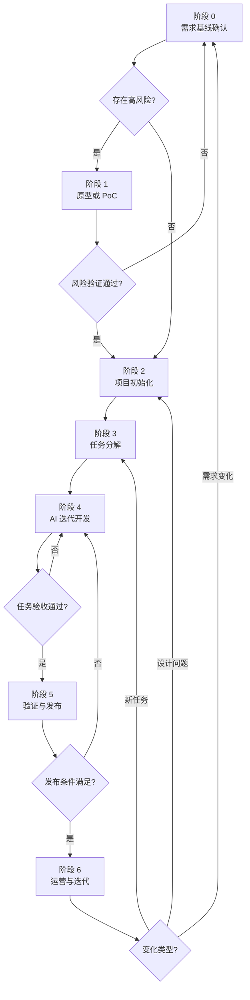

# 阶段 04：项目专属开发流程设计

## 目标

把选定的开发模型落成一条**这个项目能照着走**的路线：有哪些阶段、顺序如何、每阶段做什么、AI 和人分别负责什么、交付什么、满足什么条件才能进入下一阶段、哪些可以并行、出问题回到哪里。

本阶段同时设计 AI 协作契约，确保后续开发不是“把需求丢给 AI，等它生成代码”，而是有节奏、有验证、有边界的循环。

## 阶段骨架

默认使用下面的七段骨架，再按项目裁剪。不是每个项目都要保留七段。

| 阶段 | 目标 | 主要产物 | 是否可裁剪 |
| --- | --- | --- | --- |
| 0. 需求基线确认 | 确认要开发的范围、验收标准和约束，形成后续开发的输入 | 需求基线、范围边界、验收标准 | 可合并，但不可省略确认动作 |
| 1. 风险验证 | 用原型或 PoC 回答“这个方案是否成立” | 原型、PoC 结论、技术风险清单 | 无高风险时可省略 |
| 2. 项目初始化 | 建立可运行、可测试、可回滚的工程基础 | 项目骨架、项目指令、测试框架、Git、CI（按需） | 小项目可简化 |
| 3. 任务分解 | 把范围拆成可独立验证的小任务，排好依赖 | 任务清单、依赖关系、每项验收标准 | 不可省略 |
| 4. AI 迭代开发 | 按垂直切片逐项实现、测试、审查、提交 | 可运行的功能增量、测试记录、变更记录 | 不可省略 |
| 5. 验证与发布 | 独立验证需求、质量、安全和可用性，发布或交付 | 验证记录、发布版本、回滚方案 | 本地自用可简化发布 |
| 6. 运营与迭代 | 收集真实使用反馈，决定下一轮需求或修复 | 反馈记录、问题清单、下一轮输入 | 一次性交付可简化 |

裁剪原则：

- 个人自用的小工具：可以合并 0 和 1，简化 2 和 5，但必须保留 3、4 和基本验证。
- 高风险项目：1 必须完整执行，并设“通过/不通过”门禁。
- 高质量/合规项目：5 不能简化，需求-测试追踪和回滚方案必须保留。
- 团队项目：2 要加入接口契约、代码审查和 CI；3 要明确任务归属和并行边界。
- 维护型项目：可以弱化 0–3，把 4–6 做成持续流动。

## 每个阶段要写什么

对每个保留的阶段，填写下表：

| 项目 | 内容 |
| --- | --- |
| 阶段目标 | [一句话说明这个阶段结束时应该得到什么] |
| 输入 | [需要哪些文档、代码、决策、环境] |
| 工作内容 | [具体做什么，按顺序列出] |
| AI 负责 | [AI 可以自主完成的部分] |
| 人负责 | [必须由人做的判断、确认和验收] |
| 交付物 | [文档、代码、测试、记录、可运行版本] |
| 门禁/验收条件 | [满足什么条件才能进入下一阶段] |
| 可并行 | [哪些工作可以同时做，前提是什么] |
| 回流条件 | [出现什么问题时回到哪个阶段] |

要求：

- “AI 负责”和“人负责”必须具体，不能只写“AI 编码、人审查”。
- 门禁必须可观察，例如“测试通过”“用户完成一次真实操作”“PoC 达到预设指标”，不能写“感觉可以了”。
- 回流条件必须指向具体阶段，不能只写“回头修改”。

## 各阶段的默认做法

下面是默认建议，按项目裁剪，不要机械照搬。

### 阶段 0：需求基线确认

- 输入：`INITIAL_REQUIREMENTS.md`、用户补充说明、已有项目文档。
- 工作：确认第一版范围、验收标准、明确不做什么、已知约束；把与开发方式有关的约束写进 `DEVELOPMENT_APPROACH.md`。
- AI：整理需求、指出冲突和缺口、提出验收标准草案。
- 人：确认范围、优先级和验收标准；决定哪些内容进入第一版。
- 交付物：需求基线、范围边界、验收标准。
- 门禁：需求基线经用户确认；关键歧义已解决或标为假设。
- 注意：本阶段不重新做需求分析，也不替后续阶段决定 MVP。如果需求文档还不成熟，先回到需求阶段，而不是在这里硬定。

### 阶段 1：风险验证

- 输入：高风险点清单、技术假设、原型目标。
- 工作：做限时原型或 PoC，验证一个明确问题；记录结论和失败条件。
- AI：快速生成原型、搭建实验环境、运行验证、整理结果。
- 人：定义验证问题和通过标准；判断结果是否足以支持继续。
- 交付物：原型或 PoC、验证记录、结论、风险更新。
- 门禁：关键风险有明确结论；如果失败，方案已经调整或缩小范围。
- 注意：PoC 代码不默认进入产品；原型要明确是丢弃还是演进。

### 阶段 2：项目初始化

- 输入：需求基线、技术约束、AI 环境能力。
- 工作：建立项目骨架、项目指令（如 `AGENTS.md`）、目录结构、测试框架、Git、必要的 CI 和部署配置；准备开发环境和密钥管理。
- AI：生成骨架、配置、初始测试和项目指令草案。
- 人：确认技术边界、目录约定、测试命令和提交规范；确认没有把密钥写进代码。
- 交付物：可运行的项目骨架、项目指令、测试命令、版本管理、环境说明。
- 门禁：项目能启动；测试命令能运行；AI 能读取项目并按指令工作；变更可回滚。
- 注意：初始化只建立“能开始迭代”的基础，不一次性搭完所有架构。

### 阶段 3：任务分解

- 输入：需求基线、架构/接口草案、风险结论。
- 工作：按垂直切片拆分任务，标注依赖、验收标准、涉及文件和验证方式；排出顺序。
- AI：根据需求和代码库提出任务拆分草案、依赖关系和风险提示。
- 人：确认任务粒度、顺序和验收标准；决定哪些任务先做。
- 交付物：任务清单、依赖图、每项任务的完成定义。
- 门禁：每个任务都能独立验证；任务之间依赖清楚；没有“一次性完成整个系统”的任务。
- 注意：任务分解不是功能列表；每个任务要有可观察的结果。

### 阶段 4：AI 迭代开发

- 输入：任务清单、项目指令、相关代码和测试。
- 工作：按任务循环执行：读取上下文 → 提出计划 → 小步实现 → 运行测试/检查 → 汇报证据 → 人工确认 → 提交。
- AI：分析代码、提出计划、实现、运行测试、分析错误、更新文档。
- 人：确认计划、审查关键变更、验收结果、决定是否继续或调整。
- 交付物：可运行的功能增量、测试记录、变更记录、必要的文档更新。
- 门禁：任务验收通过；测试通过；没有未处理的回归；变更已提交。
- 注意：一次只做一个任务；不顺手重构无关模块；失败多次时停下来缩小范围。

### 阶段 5：验证与发布

- 输入：功能增量、需求基线、验收标准、测试记录。
- 工作：做技术验证、需求验证和真实使用验证；检查安全、数据、性能（按需）；准备发布和回滚。
- AI：生成测试、运行回归、整理验证证据、检查配置和日志。
- 人：做真实使用验收；确认发布条件和回滚方案；决定是否发布。
- 交付物：验证记录、发布版本、发布说明、回滚方案。
- 门禁：验收标准满足；关键路径可用；失败可回滚；用户确认可以发布。
- 注意：AI 说“测试通过”不等于独立验证；关键结论要有可复查的证据。

### 阶段 6：运营与迭代

- 输入：真实使用反馈、日志、问题清单、指标。
- 工作：收集反馈、判断问题类型（缺陷/需求/体验）、决定下一轮输入；更新需求或任务。
- AI：整理反馈、分析日志、提出改进建议、更新文档。
- 人：判断优先级、决定下一轮做什么、确认是否改变范围。
- 交付物：反馈记录、问题清单、下一轮需求或任务。
- 门禁：反馈已分类；下一轮输入明确；没有把未验证的猜测当成需求。
- 注意：这一阶段可以把问题送回阶段 0、3 或 4，但要写清楚回到哪里、为什么。

## 路线图

用 mermaid 画出阶段顺序、门禁和回流。默认模板如下，必须按项目实际情况修改，不能直接照抄。

要求：

- 节点名称与阶段表一致。
- 门禁用菱形表示，分支标签写清楚条件。
- 回流用虚线或明确的箭头，不要画成单向瀑布。
- 裁剪掉的阶段不要出现在图里，或在图中标注“按需”。
- 图后附一句说明：哪些阶段可以并行，哪些必须串行。

## 任务粒度

任务粒度直接决定 AI 能否稳定完成。默认规则：

- 一个任务 = 一个可独立验证的垂直切片，或一个边界清楚的改动。
- 一个任务应该能在一次开发循环内完成；如果需要多轮才能验证，继续拆。
- 任务要有可观察的验收结果，例如“页面能创建任务并刷新后仍在”，而不是“完成后端”。
- 任务涉及的文件和模块尽量少；跨三个以上模块时，考虑拆分或先补接口契约。
- 按用户可见行为拆分，不按技术层拆分；基础设施任务例外。
- 无法验证的任务，先补验证手段或测试夹具，再实现。

反例：

- “实现整个任务管理后端。”
- “把所有页面都接上 API。”
- “重构项目结构。”

正例：

- “创建任务：输入标题 → 保存到数据库 → 列表显示 → 刷新后仍在。”
- “任务完成状态：点击完成 → 状态更新 → 刷新后保持 → 失败时提示。”
- “AI 查询任务：用户输入查询 → 调用受控工具 → 返回真实结果 → 无结果时明确提示。”

## AI 与人如何分工

| 工作 | AI 可以做 | 人必须做 |
| --- | --- | --- |
| 理解需求 | 阅读文档、总结、指出冲突 | 确认目标、范围和验收标准 |
| 方案设计 | 提出候选方案、比较取舍 | 做关键决策，承担后果 |
| 任务拆分 | 提出拆分和依赖草案 | 确认粒度、顺序和优先级 |
| 编码 | 实现、重构、补测试 | 审查关键变更，确认没有越界 |
| 测试 | 生成并运行测试、分析失败 | 判断测试是否覆盖真实需求 |
| 调试 | 根据日志和报错分析、尝试修复 | 确认修复没有掩盖问题 |
| 文档 | 随代码更新文档 | 确认关键决策和约束准确 |
| 发布 | 准备配置、检查清单 | 决定是否发布，确认回滚方案 |

必须由人确认的节点：

- 架构和关键接口决策；
- 数据模型、数据库迁移、删除数据；
- 认证、权限、支付、敏感数据；
- 外部付费 API、模型调用成本；
- 生产环境部署和回滚；
- 范围变更、优先级调整；
- 任何不可逆或高影响操作。

## 上下文与版本管理

- 用项目指令（如 `AGENTS.md`）记录技术约定、测试命令、修改边界和完成定义。
- 需求、架构、任务和决策写在文档里，不依赖长对话记忆。
- 使用 Git；每个任务一次或几次小提交，提交信息说明“为什么改”。
- 大改动前先提交或打标签，确保可以回滚。
- 定期清理过期文档和假设，避免 AI 读取到矛盾信息。
- 上下文受限时，优先保留：需求基线、当前任务、相关代码、测试命令、已知风险。

## 测试与独立验证

按项目质量要求选择：

- 至少要有：关键路径的自动化测试或人工验收清单。
- 有自动化测试时：每个任务补对应测试；修复缺陷先补回归测试。
- 无自动化测试时：写清手工验证步骤、测试数据和预期结果；关键路径每次发布前重跑。
- 高风险功能：增加边界、失败、异常和回滚验证。
- AI 生成的测试要人工检查是否真的验证了需求，不能只看“通过”。
- 重要结论要有独立证据：测试输出、日志、截图、真实操作记录。

## 失败处理

在 AI 协作契约中写明：

- 同一问题连续尝试 2–3 次仍失败：停止，记录尝试过的方法和错误，缩小问题范围，向用户说明。
- 测试失败：先判断是代码问题、测试问题还是环境问题；不要为了通过而删除测试或放宽断言。
- 需求不清：回到需求基线，不在实现中猜。
- 设计不成立：回到阶段 1 或阶段 2，不在错误架构上继续堆功能。
- 发布失败：先回滚，再分析；不要在线上直接反复试。

## 完成定义

为项目定义“完成”的标准，至少包含：

- 代码实现符合需求基线；
- 相关测试通过，或人工验收记录完整；
- 没有未处理的回归；
- 文档和项目指令已更新；
- 变更已提交，可回滚；
- 用户确认结果可用。

## 写入文档

把结果写入 `DEVELOPMENT_APPROACH.md`：

- 第 05 节：阶段总览、mermaid 路线图、阶段明细、并行与依赖、反馈与回流。
- 第 06 节：AI 协作契约（任务粒度、单次循环、人工确认点、上下文与版本、测试、失败处理、完成定义）。
- 第 07 节：质量保障与验收（质量目标、验证层次、需求-测试追踪、评审与发布门禁、安全与数据）。

## 完成标准

- 每个保留的阶段都有目标、输入、工作内容、AI/人分工、交付物、门禁、并行和回流条件。
- 阶段表与 mermaid 路线图一致。
- 任务粒度规则能直接用于后续任务拆分。
- AI 协作契约包含单次循环和人工确认点。
- 测试、独立验证和失败处理写清楚。
- 完成定义可观察、可验收。
- 流程复杂度与项目规模匹配，没有明显过度设计。

完成后直接进入 [05-document-review.md](./05-document-review.md)。
